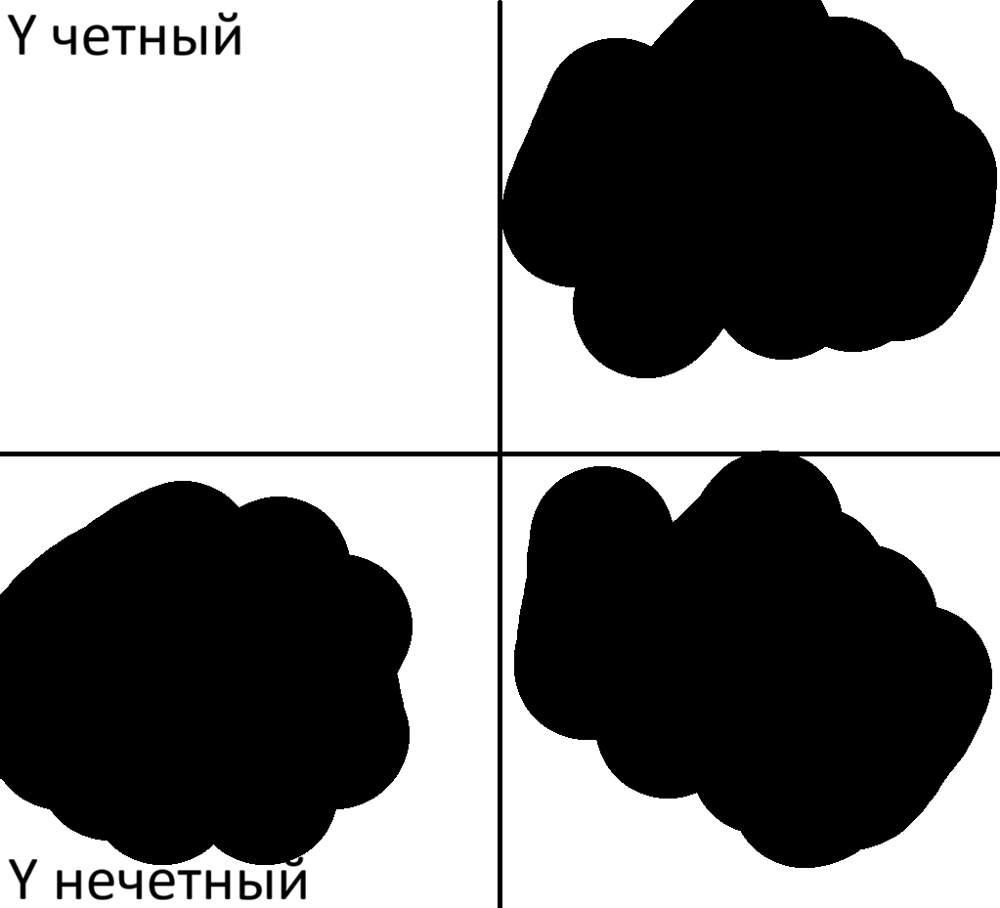
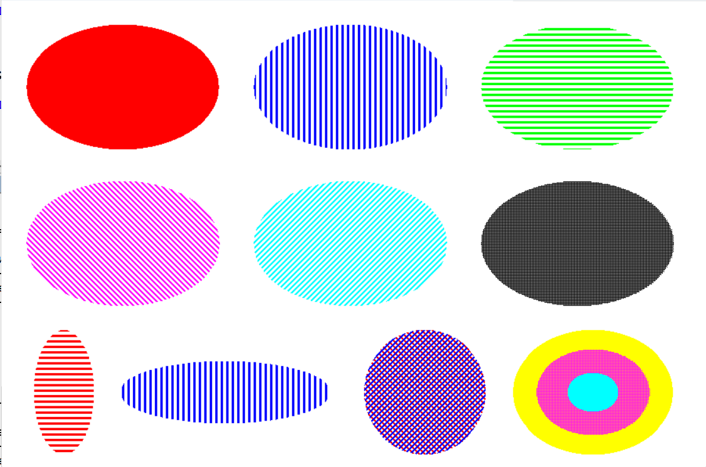
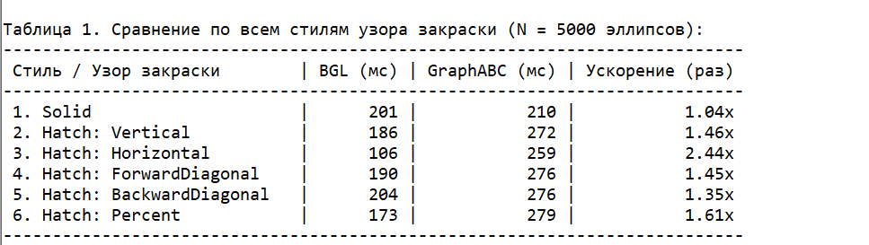
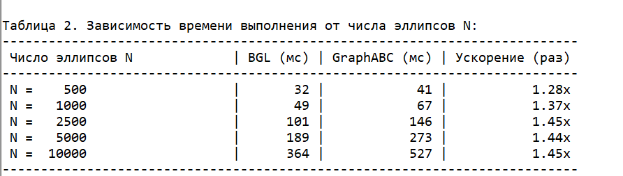
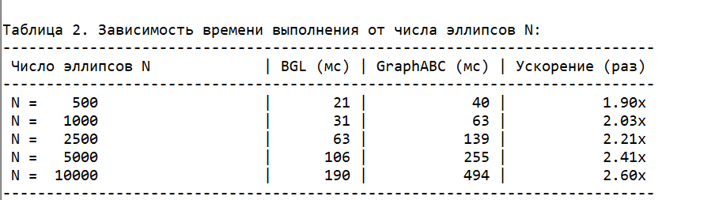

# Отчет

## Задание:
### Закрашенный эллипс с заданием узора закраски (аналогично `GraphABC`). Разработка эффективной процедуры `FillEllipse`. Экспериментальное сравнение с соответствующей процедурой `GraphABC`.

## Введение

Стандартный модуль `GraphABC` в среде `PascalABC.NET` предоставляет удобный высокоуровневый интерфейс для рисования, включая процедуру `FillEllipse` и настройку стиля кисти (`SetBrushStyle`, `SetBrushHatch`). Однако `GraphABC` построен поверх управляемой оболочки `GDI+` (System.Drawing.Graphics), каждый ее вызов сопровождается значительными расходами: созданием и проверкой объектов кисти, межъязыковыми вызовами `.NET` и попиксельной синхронизацией доступа к видеопамяти. Особенно сильно падение производительности проявляется при отрисовке большого количества фигур со сложными штриховыми и узорчатыми заливками.

Целью данной работы является: разработка эффективной процедуры `FillEllipse(x1, y1, x2, y2: integer)`, выполняющей растеризацию и закрашивание эллипса, реализация механизма задания стиля заливки и узора штриховки, аналогичного `GraphABC` (сплошная заливка, вертикальная, горизонтальная, прямая диагональная, обратная диагональная и процентная/точечная штриховки), а также экспериментальное сравнение с соответствующей процедурой `GraphABC`. 

## Алгоритм растеризации и закраски с заданием узора эллипса

### Алгоритм Брезенхема

В процедуру `FillEllipse(x1, y1, x2, y2: integer)` передаются экранные координаты левого верхнего (x1, y1) и правого нижнего (x2, y2) углов ограничивающего прямоугольника, в который вписан эллипс. По этим координатам вычисляются центр эллипса (cx, cy) и его горизонтальная и вертикальная полуоси a и b, а также их квадраты:

 ```bash
   
   a := (x2 - x1) div 2 - 1;
   b := (y2 - y1) div 2 - 1;

   cx := (x1 + x2) div 2;
   cy := (y1 + y2) div 2;
   
   a2 := sqr(a);
   b2 := sqr(b);

  ```

Каноническое уравнение эллипса с центром в начале координат:

`b²x² + a²y² - a²b² = 0`

Поскольку эллипс симметричен относительно обеих осей координат, достаточно рассчитать координаты граничных точек только в первом квадранте (`x ≥ 0`, `y ≥ 0`), а закрашивание внутренней области производить горизонтальными отрезками (скан-линиями) одновременно в верхней и нижней половинах эллипса:

* верхняя горизонтальная полоса

 ```bash

  FillBuffer(cy - y, cx - x, cx + x)

  ```

* нижняя горизонтальная полоса:

 ```bash

  FillBuffer(cy + y, cx - x, cx + x)

  ```

Для рассчета координат граничных точек в первом квадранте применим целочисленный алгоритм Брезенхема(алгоритм средней точки). Так как кривизна эллипса изменяется вдоль дуги, первый квадрант разбиваем на два участка точкой (`tanx`,`tany`), в которой касательная к эллипсу имеет наклон `dy/dx = -1` (то есть `b²*x = a²*y`). Координаты точки смены шага вычисляются перед началом циклов:

 ```bash
   tanx := round(a2 / sqrt(a2 + b2));
   tany := round(b2 / sqrt(a2 + b2));
  ```

Первый учаток (часть дуги, где x изменяется от 0 до `tanx`, а наклон касательной по модулю меньше 1)

  * Независимой переменной является координата `x`, которая увеличивается на 1 на каждом шаге. Оценочная функция `d` инициализируется значением `d := 2 * b2 - 2 * a2 * b + a2`:
    * Если `d < 0`, то следующая точка контура остается на том же уровне `y`, а оценочная функция изменяется на величину `b²*(2*x+5)`;
    * Если `d ≥ 0`, то координата `y` уменьшается на 1. Так как при переходе на новую строку `y` текущая строка полностью сформирована (достигнута максимальная ширина `x` для данного `y`), в этот момент вызывается процедура закрашивания горизонтальных полос `FillBuffer(cy - y, cx - x, cx + x)` и `FillBuffer(cy + y, cx - x, cx + x)`. Закрашивание строки буфера не дублируется при тех шагах по `x`, когда `y` не менялся. После этого оценочная функция обновляется: `d := d + b²*(2*x+5) - a²·(2y - 2)`, и выполняется `y := y - 1`.

```bash

   for x := 0 to tanx do begin
      if d < 0 then begin
         d := d + b2 * (2 * x + 5);
         end
      else begin
         FillBuffer(cy - y, cx - x, cx + x);
         FillBuffer(cy + y, cx - x, cx + x);
         
         d := d + b2 * (2 * x + 5) - a2 * (2 * y - 2);
         y := y - 1;
      end;
   end;

  ```

Второй участок(часть дуги, где `y` убывает до 0, а наклон касательной по модулю больше 1)

  * Независимой переменной становится координата `y`, которая уменьшается на 1 на каждом шаге. Так как здесь строка `y` меняется на каждой итерации, закрашивание полос `FillBuffer(cy - y, cx - x, cx + x)` и `FillBuffer(cy + y, cx - x, cx + x)` вызывается на каждом шаге.
    * Если `d < 0`, то `x` не меняется (`d := d + a²(2y - 5)`);
    * Если `d ≥ 0`, то `x` увеличивается на 1, оценочная функция принимает значение `d := d + a²(2y - 5) - b²(2x + 2)`.


```bash

   for y := y downto 0 do begin
      FillBuffer(cy - y, cx - x, cx + x);
      FillBuffer(cy + y, cx - x, cx + x);
      
      if d < 0 then begin
         d := d + a2 * (2 * y - 5);
         end
      else begin
         d := d + a2 * (2 * y - 5) - b2 * (2 * x + 2);
         x := x + 1;
      end;
   end;

  ```

Для избежания арифметического переполнения 32-битных целых чисел при вычислении выражений вида `2*a²*b` на больших размерах эллипса все расчетные переменные алгоритма имеют 64-битный целочисленный тип `int64`.

### Узоры закраски

В модуле `BGL` для управления стилем заполнения разработаны два типа, аналогичные типам `BrushStyleType` и `HatchStyle` в `GraphABC`:

* `FillStyle = (Solid, Hatch)` - задает режим закраски: сплошная заливка цветом (аналог `bsSolid`) или штриховка узором (аналог `bsHatch`);
    
* `HatchStyle = (Vertical, Horizontal, ForwardDiagonal, BackwardDiagonal, Percent)` - задает вид узора штриховки.

```bash

type
   FillStyle = (Solid, Hatch);
   HatchStyle = (Vertical, Horizontal, ForwardDiagonal, BackwardDiagonal, Percent);

  ```

Параметры геометрии штриховки определяются двумя константами в `BGL.pas`:

* `HatchOffset = 7` - период повторения штриха в пикселях;
  
* `HatchWidth = 3` - ширина окрашиваемой полосы штриха (из каждых 7 пикселей периода 3 пикселя закрашиваются текущим цветом CC, а 4 пикселя остаются фоновыми).

При закрашивании горизонтального сегмента на строке `y` от `x1` до `x2` принадлежность каждого пикселя `(x, y)` узору определяется быстрыми целочисленными и побитовыми операциями в экранной системе координат (благодаря чему узор привязан к глобальной сетке экрана, как в GraphABC, и при наложении нескольких фигур линии штриховки идеально стыкуются без швов):

* Сплошная заливка (`FillStyle.Solid`): Нужно закрасить эллипс целиком. Для этого необходимо просто взять весь отрезок от `x1` до `x2` на строке `y` и залить его цветом. Поскольку экран в памяти хранится как сплошной одномерный массив `LB` шириной `SizeX`, координаты пикселей на строке `y` лежат в памяти строго подряд. Для всего этого вызывается быстрая процедура `Fill(firstpixel, lenghtptr, color)`:

```bash

  Fill(SizeX * y + x1, x2 - x1, CC)

  ```

* Вертикальная штриховка (`HatchStyle.Vertical`): Нужно заполнить эллипс вертикальными прямыми отрезками. Чтобы полосы были вертикальными, цвет пикселя должен зависеть только от координаты `x` (по горизонтали). Берётся остаток от деления координаты на период:
  
  ```bash
  
    x mod 7 < 3 #(x mod HatchOffset < HatchWidth)
  
    ```
  * Этот остаток пробегает значения от 0 до 6:
    
      * 0, 1, 2 - условие x mod 7 выполняется значит закрашиваем;
          
      * 3, 4, 5, 6 - условие не выполняется значит пропускаем.
  
  * На любых строках `y` одни и те же столбцы `x` либо красятся, либо нет. Получаются вертикальные полосы: 3 пикселя цвета(ширина полосы) + 4 пикселя фона(интервал) + 3 пикселя цвета и так далее.

  ```bash
  
  procedure FillBufferVertical(y, x1, x2: integer);
   var
      x, rowOffset: integer;
   begin
      rowOffset := SizeX * y;
      for x := x1 to x2 do
         if x mod HatchOffset < HatchWidth then
            LB[rowOffset + x] := CC; #перебор y от левого края до правого
   end;
  
    ```

* Горизонтальная штриховка (`HatchStyle.Horizontal`): Нужно заполнить эллипс горизонтальными прямыми отрезками. То есть все будет наоборот по сравнению с вертикальным узором. Чтобы полосы были горизонтальными, цвет пикселя должен зависеть только от координаты `y` (по вертикали). Берётся остаток от деления координаты на период:
  
  ```bash
  
    y mod 7 < 3 #(x mod HatchOffset < HatchWidth)
  
    ```
  
  * Этот остаток пробегает значения от 0 до 6:
    
      * 0, 1, 2 - условие y mod 7 выполняется значит закрашиваем;
          
      * 3, 4, 5, 6 - условие не выполняется значит пропускаем.
  
  * Поскольку отрезок от `x1` до `x2` лежит на одной и той же строке `y`, значение `y` для всех его пикселей одинаковое. Это значит, что по сравнению с процедурой для вертикальной штриховки цикл по `x` не нужен:

  ```bash
  
  procedure FillBufferHorizontal(y, x1, x2: integer);
  begin
    if y mod HatchOffset < HatchWidth then
      Fill(SizeX * y + x1, x2 - x1, CC);
  end;
  
    ```

  * Поэтому горизонтальная штриховка выполняется даже быстрее, чем сплошная заливка (ведь 4 строки из каждых 7 процессор вообще не трогает).
  
* Диагональная штриховка (`HatchStyle.ForwardDiagonal`): Нужно заполнить эллипс линиями штрихов, которые идут под углом 45° по направлению сверху-слева направо-вниз.
  
  * В геометрии прямая линия с наклоном 45° сверху-вниз задается уравнением: `x - y = C`. Если бы взяли просто `(x - y) mod 7`, то при `y > x` результат разности `(x - y)` стал бы отрицательным. И чтобы число гарантированно всегда было положительным, к нашему выражению `(x - y)` прибавляем SizeY и получаем `(x + (SizeY - y))`. Теперь проверяем условие:
  
    ```bash
  
      baseDiag := SizeY - y;
      (x + baseDiag) mod HatchOffset < HatchWidth
    
      ```

  * Так как `baseDiag` одинаков для всей строки `y`, он вычисляется один раз перед циклом, а внутри цикла для каждого `x` остаётся только сложение и взятие остатка:

  ```bash
    
    procedure FillBufferForwardDiagonal(y, x1, x2: integer);
     var
        x, rowOffset, baseDiag: integer;
     begin
        rowOffset := SizeX * y;
        baseDiag := SizeY - y;
        for x := x1 to x2 do
           if (x + baseDiag) mod HatchOffset < HatchWidth then
              LB[rowOffset + x] := CC;
     end
    
    ```

  * При переходе на строку ниже (`y` увеличивается на 1) окрашиваемый пиксель сдвигается на 1 вправо (`x` увеличивается на 1) - в результате формируются диагональные линии толщиной 3 пикселя.
  
* Обратная диагональная штриховка (`HatchStyle.BackwardDiagonal`): Нужно заполнить эллипс линиями штрихов, которые идут под углом 45° по направлению снизу-слева направо-вверх.

  * Все то же самое, что и у процедуры диагональной штриховки, но уравнение задается следующим образом `x + y = C` и так как `x + y` всегда положительна, то никаких сдвигов делать не нужно:

    ```bash
    
    procedure FillBufferBackwardDiagonal(y, x1, x2: integer);
     var
        x, rowOffset: integer;
     begin
        rowOffset := SizeX * y;
        for x := x1 to x2 do
           if (x + y) mod HatchOffset < HatchWidth then
              LB[rowOffset + x] := CC;
     end;
    
    ```

* Точечная (процентная) штриховка (`HatchStyle.Percent`): Нужно заполнить эллипс линиями штрихов "сетка", то есть заполнить 75% площади эллипса(аналог `bhPercent75` из `GraphABC`).

  * Операция `mod` требует от процессора нескольких тактов. Но если кратность равна 2, то ее можно заменить мгновенной побитовой операцией побитового `and` с единицей, то есть

    * Если строка `y` нечетная ((y and 1) <> 0), она закрашивается полностью через `Fill(SizeX * y + x1, x2 - x1, CC)`;
      
    * Если строка `y` четная, на ней закрашиваются все нечетные пиксели `((x and 1) <> 0)`.

    

  ```bash
     
   procedure FillBufferPercent(y, x1, x2: integer);
   var
      x, rowOffset: integer;
   begin
      if (y and 1) <> 0 then
         Fill(SizeX * y + x1, x2 - x1, CC)
      else begin
         rowOffset := SizeX * y;
         for x := x1 to x2 do
            if (x and 1) <> 0 then
               LB[rowOffset + x] := CC;
      end;
   end;
    
    ```

## Экспериментальное сравнение с соответствующей процедурой `GraphABC`.

### 1. Модуль `Display`.

В модуле `Display.pas` организован прямой доступ к видеопамяти через одномерный массив `LB: array [0..Size-1] of tPixel`, связанный с растровым объектом `.NET` через неуправляемый указатель `System.IntPtr`. Благодаря этому запись цвета точки `LB[SizeX * y + x] := CC` происходит непосредственно в оперативную память без обращения к интерфейсам `GDI+`.

### 2. Визуальное тестирование эллипса и его закраски разными стилями.

В процедуре `TestAllPatternsVisual` тестовой программы `Ellipse.pas` было реализовано 10 различных сценариев: 

* Базовые стили (`Solid`, `Hatch Vertical`, `Hatch Horizontal`);   

* Диагональные (`ForwardDiagonal`, `BackwardDiagonal`) и точечный узоры;   

* Геометрические предельные случаи (сильно вытянутый вертикальный эллипс `a < b`, сплюснутый горизонтальный эллипс `a > b`, окружность `a = b` с наложением двух диагоналей для эффекта перекрестной сетки, а также концентрические вложенные эллипсы для проверки симметрии и центровки).

  

### 3. Экспериментальное сравнение быстродействия `BGL` и `GraphABC`.

Сравнение проводилось с параметрами окна `900x600` и размером эллипса `200x140`.

* В первой таблице даны результаты при 5000 эллипсов с замером времени для каждого из шести стилей узора закраски.

 

* Во второй таблице рассматривалась зависимость времени выполнения от количества эллипсов(500, 1000, 2500, 5000, 10000) на прямой диагональной штриховке (`ForwardDiagonal` против `bhForwardDiagonal`), так как она самая трудоемкая.

 

* Также был проведен эксперимент с горизонтальной штриховкой.

   

### 4. Вывод.

На основе экспериментальных данных видно, что разработанная процедура `BGL.FillEllipse` стабильно превосходит стандартную `GraphABC.FillEllipse` во всех режимах закраски, обеспечивая ускорение от `1.04x` до `2.44x`. Наивысшую скорость (в 2.44 раза: 106 мс против 259 мс) показала горизонтальная штриховка. Это связано с тем, что условие узора проверяется всего один раз на всю строку: 4 из каждых 7 линий эллипса полностью пропускаются без попиксельного перебора, а окрашиваемые строки заливаются целиком за один шаг. Высокую скорость показал и процентный точечный узор (ускорение `1.61x`) благодаря замене деления на быструю побитовую проверку нечётности. Эксперимент с изменением количества фигур подтверждает строгую линейную сложность `O(N)` обоих алгоритмов: начиная с 2500 эллипсов преимущество BGL становится на уровне примерно `1.45x`, доказывая высокую эффективность прямого доступа к кадровому буферу без накладных расходов системных графических библиотек.
